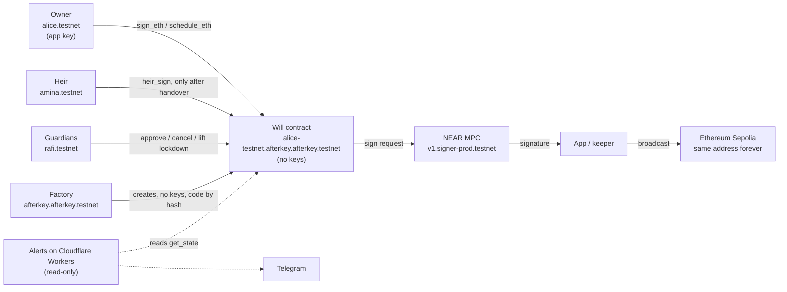
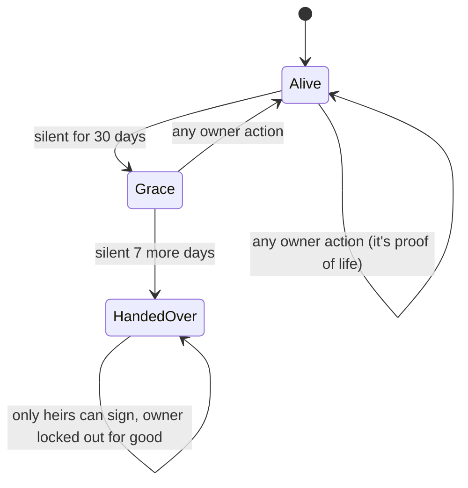

# Afterkey

**A seedless crypto wallet with a will built in.** Use it every day. If you stop showing up, the person you chose inherits the *wallet itself*: same address, same positions, NFTs, points, and every airdrop that lands later. If someone forces you to send, the big money waits.

Built on **NEAR Chain Signatures**. NEAR Hackathon 2026 · Open Innovation.

| | |
|---|---|
| Live app (testnet) | **[LIVE_URL]** |
| Demo video | **[VIDEO_URL]** |
| Factory contract | [`afterkey.afterkey.testnet`](https://testnet.nearblocks.io/address/afterkey.afterkey.testnet) |
| MPC signer used | `v1.signer-prod.testnet` |
| Will code hash | `14BJ7babJEt5NHpC6nYHK23C37FwVsieahTLsCbNMqRa` |
| Tests | 54 contract unit tests (`cargo test`) |

> Testnet only, unaudited. Don't put real funds in it.

---

## The problem

Crypto has no inheritance. A wallet is a private key, and a key dies with its owner. Billions in BTC and ETH already sit in wallets nobody can open again.

The usual fix, a "crypto will" that sweeps balances to an heir, only moves *coins*. It leaves behind everything tied to the address: LP positions, staked and vesting tokens, NFTs, ENS names, protocol points, and airdrops that arrive after the owner is gone.

And there's a second, quieter problem: **wrench attacks**. Holders get kidnapped and forced to send everything, because a normal wallet can send everything instantly.

## The idea

With NEAR Chain Signatures, an address on Ethereum, Solana or Bitcoin can be controlled by a **NEAR smart contract** instead of a private key. The contract asks NEAR's MPC network to sign for it.

So the will doesn't move anything. It changes **who the contract signs for**:

- while you're active, it signs only for you, under anti-coercion rules;
- once you've been silent for `alive + grace` (30 + 7 days), it signs only for your heir, forever.

Your heir gets the same address with everything in it. No seed phrase ever exists, so there's nothing to lose, leak, or force out of you.

## How it uses NEAR

| NEAR feature | What Afterkey does with it |
|---|---|
| **Chain Signatures (MPC)** | Each will contract controls ETH/SOL/BTC addresses derived from its own account + path (`eth-1`, `sol-1`, `btc-1`) and calls `v1.signer-prod.testnet` → `sign` |
| **Smart contracts (Rust, near-sdk 5)** | The will enforces the death clock, the heir handover, daily limits, the 48h hold, guardians and the duress key |
| **Global contracts (code by hash)** | The will code is published once and every will references it by hash, so the code can never change and each will costs ~0.5 NEAR |
| **Keyless accounts** | The factory creates each will on an account with **no access keys**: nobody, including us, can upgrade, pause or drain it |
| **Function-call access keys** | The app key and the duress key are function-call keys scoped to the user's will; the contract tells them apart with `signer_account_pk()` |
| **Block time** | The handover is triggered by `block_timestamp` alone: no oracle, no "report a death" button |

## Architecture



### The death clock



Every transaction the owner signs is a heartbeat, so there's no check-in to forget. A manual check-in button exists for quiet months.

## Kidnap protection

| Rule | What it does |
|---|---|
| **Daily limit** | Plain ETH sends whose value **plus the maximum gas fee** fit today's limit are instant |
| **48h hold** | Over-limit sends and **every contract call** wait. You or a guardian can cancel |
| **Trusted addresses** | Your own Ledger or exchange deposit: any amount, instantly. Adding one waits 48h |
| **Guardians** | Approve a held send (it goes now), cancel it, block a settings change, lift a lockdown. Never take funds |
| **Duress password** | Opens the app exactly like the real one. It signs at most **one** small decoy, locks the will for 7 days, and alerts guardians, never the owner's chat |
| **Slow settings** | Tightening (remove a trusted address, lower the limit) is instant. Loosening waits 48h, so nobody can force you to turn protection off |
| **Device recovery** | Lost the app key? Your normal wallet can request a new one. It waits 48h and guardians are alerted |

Moving a big amount yourself: **schedule it** (released after 48h), send to a **trusted address** (instant), or ask a **guardian** (instant).

## Security model

- **No seed phrase** exists for the ETH/SOL/BTC addresses.
- **No admin key.** Each will lives on an account with zero access keys, running code referenced by hash. Verify it yourself below.
- **One contract per user**, so there's no shared pool to drain.
- **The contract builds the Ethereum transaction itself** (EIP-1559 RLP), so it knows the recipient, value and calldata before signing. Its hashing is tested byte-for-byte against `eth-account`, and the app cross-checks the contract's hash before broadcasting.
- **A plain NEAR wallet login can't move funds.** Owner actions need a registered Afterkey app key.
- **Time is the only trigger.** The alerts service and keeper can only read, or push forward what the contract already allows.

### Verify it on-chain

```bash
# The factory's config: MPC signer, will code hash, storage deposit
near contract call-function as-read-only afterkey.afterkey.testnet get_config json-args '{}' network-config testnet now

# Any will has NO access keys: nobody can redeploy or drain it (expect an empty list)
near account list-keys <owner>-testnet.afterkey.afterkey.testnet network-config testnet now

# A will's live state: phase, deadlines, heirs, guardians, limits, queue
near contract call-function as-read-only <owner>-testnet.afterkey.afterkey.testnet get_state json-args '{}' network-config testnet now
```

## Walkthrough for judges (about 10 minutes)

You need three NEAR **testnet** accounts (create them free at [testnet.mynearwallet.com](https://testnet.mynearwallet.com)): an **owner** with ~1 NEAR, a **guardian**, and an **heir**. Use three browser profiles, because a browser holds one wallet login at a time.

1. **Owner → create a will.** Open [LIVE_URL] → *Open app* → *Connect NEAR wallet*. Enter the heir and guardian accounts, choose **Demo timers** (2 min alive, 1 min grace, 30 s hold), set an app password and a different duress password. Approve both wallet requests.
2. **Fund the wallet.** Unlock with the app password. Copy the ETH address on the dashboard and send it ~0.1 Sepolia ETH from any Sepolia faucet. Note the address: it belongs to a NEAR contract, and no private key exists for it.
3. **Instant send.** Send 0.005 ETH anywhere. It's inside the daily limit, so it's signed by the MPC network and goes out immediately (explorer link shown).
4. **Held send.** Send 0.06 ETH. It's over the 0.05 ETH daily limit, so the contract refuses to sign it instantly. Choose **Ask a guardian**.
5. **Guardian approves.** In the guardian profile: *Guarding* tab → enter the owner's account → *Link* → **Approve now**. It goes out.
6. **Duress.** In the owner profile, reload and unlock with the **duress** password. Send anything: the app says *Sent*, but only a tiny decoy can leave. The guardian's tab now shows the will **locked** with a warning.
7. **Inheritance.** Leave the owner alone. The heartbeat flatlines into **grace** after 2 minutes and **hands over** 1 minute later. In the heir profile: *Inheriting* → enter the owner's account → *Link* → **Move everything to this address**. The ETH leaves from the **same address** the owner used.

The landing page also plays this whole cycle on a 60-second loop. Use **Dark / White** and **Animations on/off** in the top bar.

## Repository

```
contracts/will      the will (Rust, near-sdk 5): death clock, heirs, limits, hold, guardians, duress. 49 tests
contracts/factory   creates keyless wills that reference the will code by hash. 5 tests
app/                React + Vite: landing page, owner / guardian / heir app, Dark/White, animations on/off
alerts/             Telegram alerts on Cloudflare Workers' free tier. One deployment serves every user
keeper/             optional: sends scheduled transfers by itself when their hold ends
scripts/            build-contracts.sh, deploy-testnet.sh
```

## Run it yourself

```bash
# contracts: tests + build (Rust, cargo-near)
./scripts/build-contracts.sh

# deploy to testnet (near-cli-rs; ~31 NEAR: publishing the shared will code costs ~28)
ACCOUNT=yourname.testnet ./scripts/deploy-testnet.sh

# web app
cd app && npm install
VITE_FACTORY=afterkey.yourname.testnet VITE_TELEGRAM_BOT=YourBot npm run dev

# Telegram alerts: see alerts/README.md (free, no server)
# optional keeper: see keeper/keeper.mjs
```

## Limitations (honest list)

- **SOL and BTC** wallets are in every will and pass to heirs, and heirs can sign from them. Sending from them as the *owner* isn't in the app yet, and the contract can't read SOL/BTC transactions, so it treats every owner SOL/BTC send as "large" (hold or guardian).
- **DeFi calls** (swaps, LP) always go through the hold or a guardian, unless the protocol is a trusted address. Trusting a router lets the app key route funds through it, so it's a deliberate owner choice.
- **Assets must live in Afterkey wallets.** Nothing can take over an existing MetaMask, because its private key is the only way to control it.
- **Unaudited, testnet.**

## Roadmap

- **Next:** SOL and BTC sends readable by the contract · guardian freeze · "protected" badge for X profiles · staged handover with a monthly allowance first · travel mode · last letters for heirs
- **Later:** sealed will (heirs hidden until handover) · claim links for heirs with no crypto · 2-of-3 heirs · sweep tokens and NFTs from an old MetaMask · audit, then mainnet

## License

MIT
